<p align="center">
  
</p>

<h1 align="center">Termínovník</h1>

<p align="center">
  <b>Plánovač zkoušek, rozvrhu a deadlinů napojený na IS/STAG</b><br>
  iOS 17+ · watchOS 10+ · Swift · SwiftUI · SwiftData · MVVM
</p>

<p align="center">
  <a href="https://github.com/liborvyleta/terminovnik/actions/workflows/ci.yml"></a>
  
  
  
  
</p>

<p align="center">
  Závěrečný projekt předmětu AP9PT – Univerzita Tomáše Bati ve Zlíně, Fakulta aplikované informatiky<br>
  Autor: Libor Výleta
</p>

---

Termínovník spojuje na jednom místě všechno, co student během semestru hlídá: rozvrh, termíny zkoušek, známky a vlastní deadliny. Data si po přihlášení školním účtem načte přímo z informačního systému IS/STAG, připomene blížící se termíny a upozorní na nově vypsané zkoušky, nové známky i změny v rozvrhu. Kromě aplikace pro iPhone nabízí widgety, Live Activity, akce pro Siri a aplikaci pro Apple Watch.

> **Neoficiální aplikace.** Termínovník není produktem IS/STAG ani žádné univerzity. K datům přistupuje přes veřejné webové služby IS/STAG zvolené školy.

## Ukázky

<p align="center">
  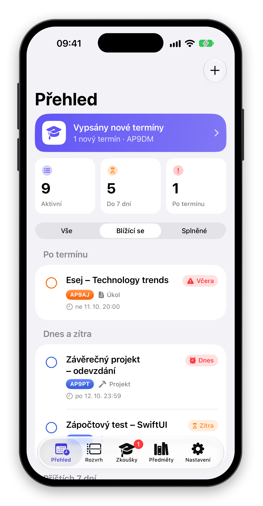
  &nbsp;
  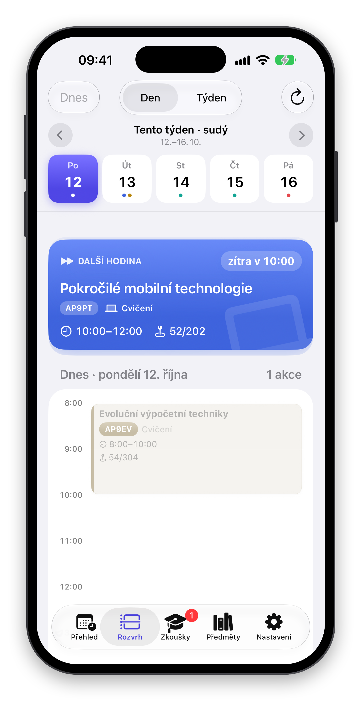
  &nbsp;
  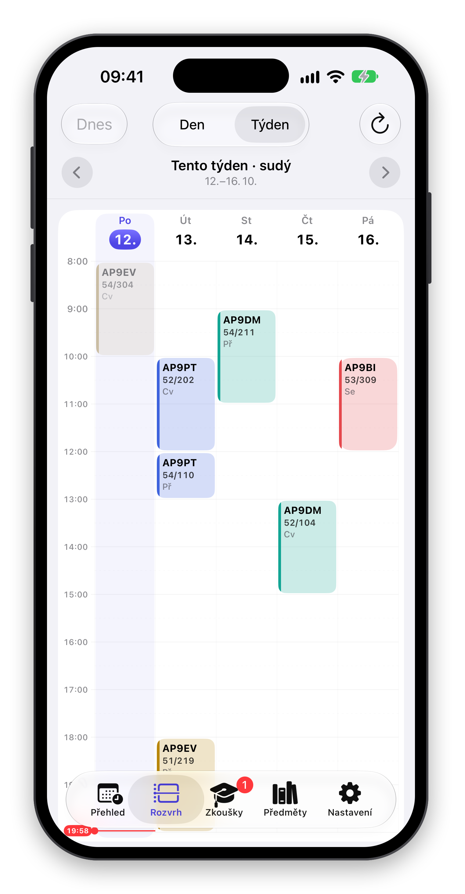
</p>
<p align="center">
  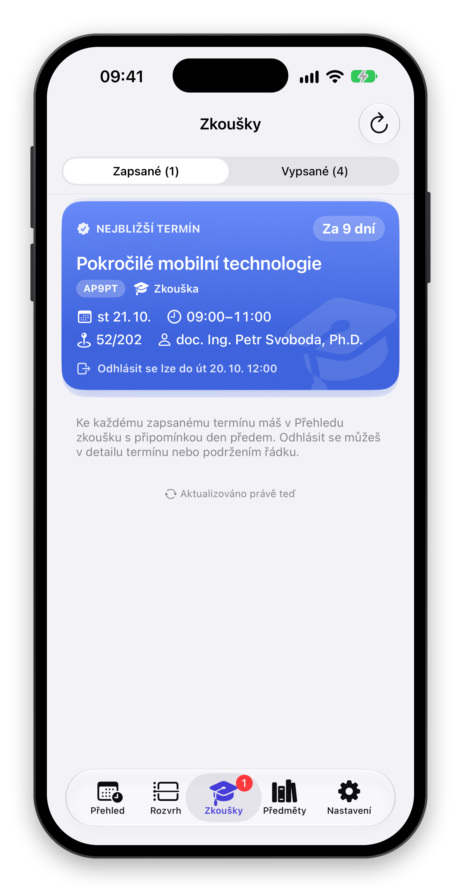
  &nbsp;
  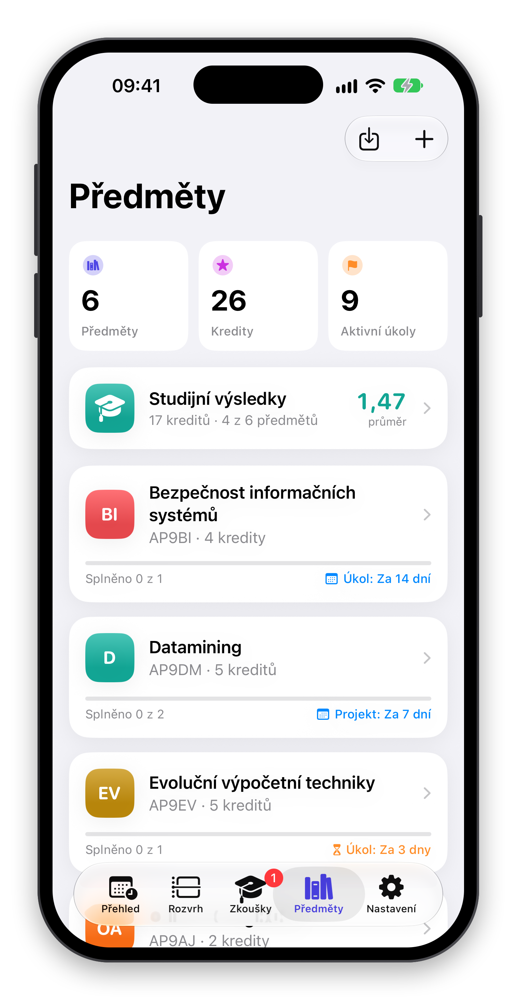
  &nbsp;
  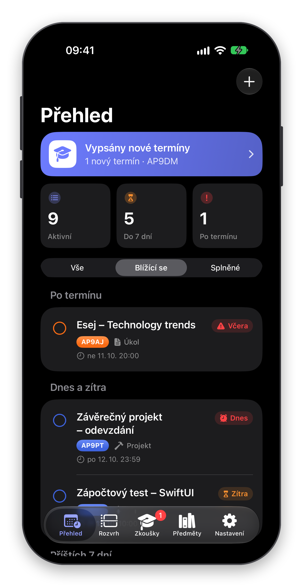
</p>
<p align="center">
  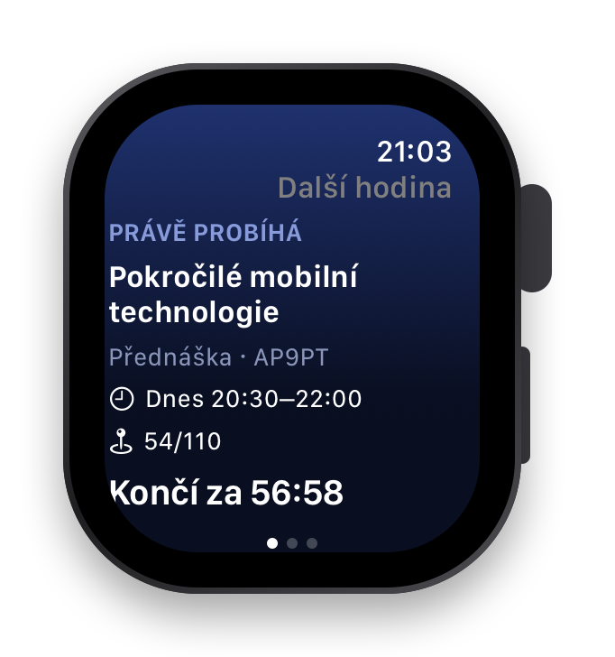
  &nbsp;
  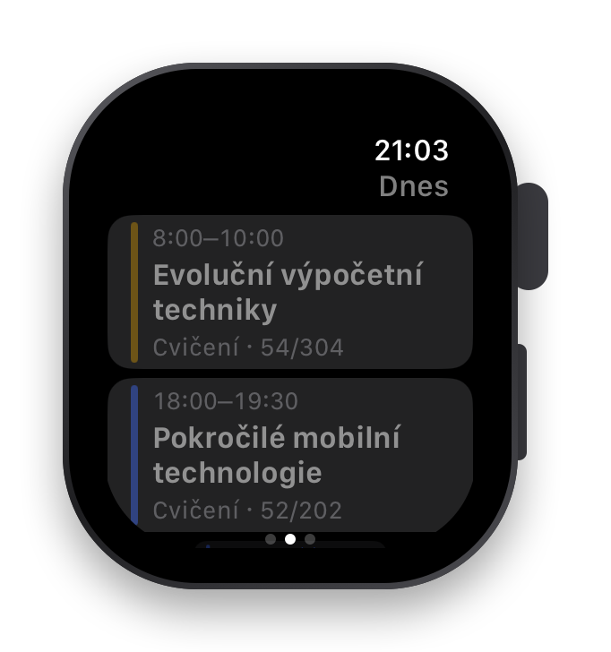
  &nbsp;
  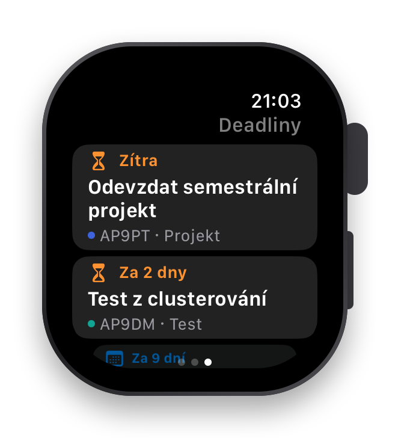
</p>

<p align="center"><sub>Snímky pochází z ukázkového režimu se smyšlenými daty.</sub></p>

## Funkce

**Studium ze STAGu**
- Přihlášení školním účtem přes systémový zabezpečený prohlížeč – aplikace heslo nikdy nevidí.
- Import zapsaných předmětů s kódem a kredity. Na výběr je 7 univerzit se systémem IS/STAG i vlastní adresa serveru (ověřeno na UTB, viz [Podporované školy](#podporované-školy)).
- Rozvrh jako denní časová osa i týdenní mřížka, zvýraznění probíhající a další hodiny, funguje i offline.
- Termíny zkoušek: zapsané i vypsané s obsazeností, **zápis a odhlášení přímo z aplikace** včetně fronty čekatelů. Každá změna ve STAGu vyžaduje potvrzení.
- Známky a studijní výsledky po semestrech, vážený průměr podle kreditů a získané kredity.
- Mapa budovy u hodiny i zkoušky s pěší navigací v Apple Mapách.

**Deadliny a připomínky**
- Přehled úkolů seskupený podle naléhavosti (*Po termínu*, *Dnes a zítra*, *Příštích 7 dní*, *Později*) s barevným odpočtem.
- Vyhledávání, filtry, odškrtnutí jedním klepnutím a gesta pro splnění, úpravu a smazání.
- Připomínka den před termínem s akcí **Splněno** přímo v oznámení.
- Oznámení o nově vypsaných termínech, nových známkách a o zrušené či přesunuté hodině.
- Upozornění před začátkem hodiny s nastavitelným předstihem.

**Systémová integrace**
- Widgety na plochu a zamčenou obrazovku, odškrtnutí deadlinu přímo z widgetu.
- Live Activity s odpočtem hodiny nebo zkoušky v Dynamic Islandu.
- Siri, Zkratky a Spotlight: další hodina, rozvrh na den, nejbližší zkouška, přidání deadlinu.
- Přidání termínu do Kalendáře bez nutnosti oprávnění ke kalendáři.
- Aplikace pro Apple Watch: další hodina, dnešní rozvrh a nejbližší deadliny.

**Ostatní**
- Záloha a obnova dat do souboru (např. na iCloud Drive), synchronizace přes iCloud připravená v kódu.
- Ukázkový režim se smyšlenými daty pro vyzkoušení bez školního účtu.
- Čeština a angličtina, světlý i tmavý režim, Dynamic Type a VoiceOver.

## Jak aplikace funguje

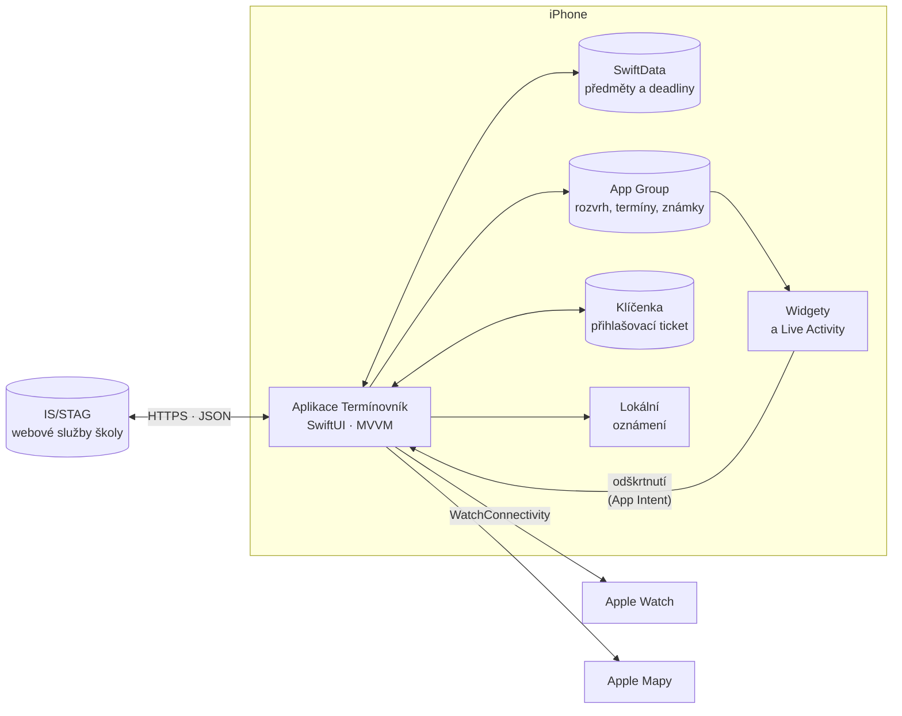

1. **Přihlášení.** Aplikace otevře přihlašovací stránku školy v `ASWebAuthenticationSession`. Po přihlášení STAG vrátí dlouhodobý ticket (platí až 90 dní), který se uloží do Klíčenky.
2. **Načtení dat.** `StagService` volá webové služby IS/STAG (předměty, rozvrh, termíny, známky, budovy). Vlastní data uživatele – předměty a deadliny – se ukládají do SwiftData, data ze STAGu do sdíleného úložiště App Group, odkud je čtou i widgety.
3. **Obnova a upozornění.** Při každém otevření aplikace a průběžně na pozadí se data obnoví. Porovnáním s předchozím stavem aplikace pozná nový termín, novou známku nebo změnu v rozvrhu a pošle oznámení. Zapsané termíny se automaticky stanou deadliny s připomínkou.
4. **Rozšíření.** Widgety a Live Activity čtou připravené snímky dat, aplikace pro Apple Watch je dostává přes WatchConnectivity.

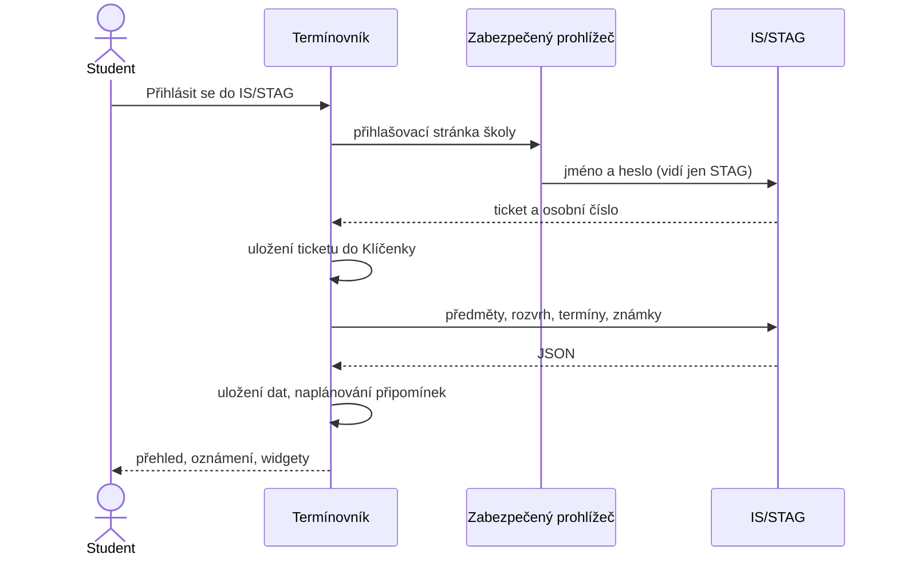

## Architektura

Aplikace je rozdělená podle vzoru **MVVM**:

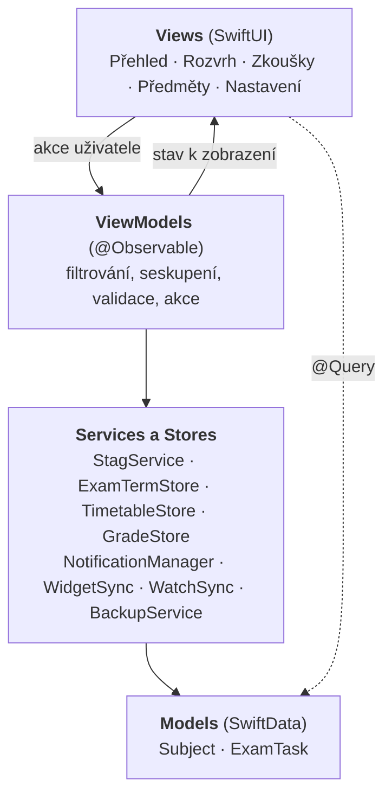

- **Views** pouze vykreslují stav. Data ze SwiftData čtou přes `@Query`, protože jen ve View se SwiftUI při změně dat automaticky překreslí, a předávají je ViewModelu.
- **ViewModels** obsahují logiku obrazovek – vyhledávání, filtry, seskupení podle termínu a validaci formulářů. Formulář drží rozpracované hodnoty, takže *Zrušit* nic nezmění.
- **Services a Stores** zajišťují komunikaci se STAGem, oznámení, widgety a hodinky. Stores jsou `@Observable`, View se na ně může navázat přímo.
- **Models** jsou dvě entity SwiftData, `Subject` a `ExamTask`, ve vztahu 1:N s kaskádovým mazáním.

Projekt používá výchozí izolaci `MainActor` (Swift 6.2 *approachable concurrency*) – UI i databáze běží na hlavním vlákně a síťová volání jsou `async`.

| Data | Úložiště | Důvod |
|---|---|---|
| Předměty a deadliny | SwiftData (SQLite) | vlastní data uživatele, přístupná i z App Intents |
| Rozvrh, termíny, známky, budovy | JSON v App Group | offline cache ze STAGu, čtou ji widgety |
| Přihlašovací ticket | Klíčenka | citlivý údaj, pouze na tomto zařízení |
| Záloha | soubor `.terminovnik` | přenos dat mezi zařízeními |

### Použité služby IS/STAG

| Služba | Účel |
|---|---|
| `kalendar/getAktualniObdobiInfo` | aktuální semestr |
| `predmety/getPredmetyByStudent`, `getPredmetInfo` | zapsané předměty a kredity |
| `rozvrhy/getRozvrhByStudent` | rozvrh studenta |
| `terminy/getTerminyProStudenta` | zapsané a vypsané termíny zkoušek |
| `terminy/zapisStudentaNaTermin`, `odhlasStudentaZTerminu` | zápis a odhlášení z termínu |
| `terminy/zapisStudentaDoFronty`, `odhlasStudentaZFronty` | fronta čekatelů |
| `znamky/getZnamkyByStudent`, `student/getStudentPredmetyAbsolvoval` | známky a studijní výsledky |
| `mistnost/getBudovy` | adresy a souřadnice budov |

### Podporované školy

Aplikace byla vyvíjena a otestována se skutečným studentským účtem na **Univerzitě Tomáše Bati ve Zlíně**. V nabídce jsou dále Západočeská univerzita v Plzni, Jihočeská univerzita, Technická univerzita v Liberci, Univerzita Pardubice, Univerzita Hradec Králové a Univerzita J. E. Purkyně a lze zadat i vlastní adresu serveru.

Všechny tyto školy provozují stejný systém IS/STAG se stejným rozhraním webových služeb, aplikace s nimi proto komunikuje shodně. **Na ostatních školách však funkčnost ověřena nebyla.** Rozdíly mohou vzniknout zejména v:

- přihlašovací stránce školy (jednotné přihlášení, návrat do aplikace po přihlášení),
- rozsahu povolených služeb – škola může například vypnout zápis na termín přes webové služby nebo veřejný seznam budov,
- verzi systému a úplnosti dat (např. chybějící souřadnice budov).

Odpovědi STAGu nejsou typově jednotné (čísla jako text, příznaky `A`/`N`, hodnoty v obalu `{"value": …}`), proto je dekódování tolerantní a jedna chybná položka nezpůsobí selhání celého seznamu.

## Struktura projektu

```
ZavernyProjekt/              aplikace pro iPhone
├── App/                     vstupní bod aplikace
├── Models/                  SwiftData modely a datové typy (předmět, deadline, termín, známka, škola)
├── ViewModels/              logika obrazovek (@Observable)
├── Views/                   SwiftUI obrazovky a komponenty
├── Services/                klient STAGu, úložiště dat, oznámení, widgety, hodinky, záloha
├── Intents/                 akce pro Siri, Zkratky a Spotlight
└── Helpers/                 pomocná rozšíření
Shared/                      kód sdílený aplikací, widgetem a hodinkami, katalog překladů
ZkouskovnikWidget/           widgety a Live Activity (WidgetKit, ActivityKit)
TerminovnikWatch/            aplikace pro Apple Watch
ZavernyProjektTests/         unit testy (Swift Testing)
docs/screenshots/            snímky obrazovek v rámečku zařízení (README)
docs/appstore/               snímky v rozměrech pro App Store (iPhone 6,9", Apple Watch)
Tools/                       generátor ikony aplikace
```

## Technologie

| Oblast | Použito |
|---|---|
| UI | SwiftUI, SF Symbols |
| Data | SwiftData, Keychain Services, App Groups |
| Síť | URLSession, async/await, ASWebAuthenticationSession |
| Systém | WidgetKit, ActivityKit, App Intents, UserNotifications, BackgroundTasks, EventKitUI, MapKit |
| Hodinky | watchOS, WatchConnectivity |
| Kvalita | Swift Testing (195 testů), GitHub Actions (build a testy při každém pushi), String Catalog (cs, en), Privacy Manifest |

## Spuštění

1. Otevři `ZavernyProjekt.xcodeproj` v Xcode 26 nebo novějším.
2. Vyber simulátor nebo zařízení s iOS 17+ a spusť schéma **ZavernyProjekt** (⌘R).
3. Pro spuštění na vlastním iPhonu nastav v *Signing & Capabilities* svůj vývojářský tým u všech targetů.

Projekt nepoužívá žádné externí balíčky.

### Ukázkový režim

Bez školního účtu lze aplikaci vyzkoušet tlačítkem **Vyzkoušet s ukázkovými daty** na úvodní obrazovce. Ukázkový režim používá smyšlený účet, rozvrh, termíny a známky, nepřipojuje se ke STAGu a nijak nemění skutečná data. Ukončí se tlačítkem *Ukončit* v banneru nebo v Nastavení.

Pro vývoj lze ukázkový režim zapnout i argumentem spuštění `-demo` (pouze Debug), volitelně s `-tab dashboard|timetable|terms|subjects|settings` a `-timetableMode day|week`.

## Testy

Unit testy pracují pouze s daty v paměti a nevolají síť. Pokrývají dekódování odpovědí STAGu, převod známek a vážený průměr, výpočet výskytů hodin včetně přechodu na letní čas, detekci změn v rozvrhu, zálohu a obnovu, ukázkový režim a logiku ViewModelů.

```bash
xcodebuild test -project ZavernyProjekt.xcodeproj -scheme ZavernyProjekt \
  -destination 'platform=iOS Simulator,name=iPhone 17 Pro' -testLanguage cs -testRegion CZ
```

## Soukromí a bezpečnost

- Data se odesílají pouze na server IS/STAG zvolené školy, a to výhradně přes HTTPS. Aplikace neobsahuje analytiku ani reklamy.
- Přihlašovací ticket je uložený v Klíčence a nikdy se nezálohuje. Odhlášení smaže ticket, uložená data ze STAGu i cookies.
- Zápis na termín a odhlášení z něj se provedou až po výslovném potvrzení.
- Aplikace i rozšíření obsahují Privacy Manifest; aplikace nesbírá žádná data o uživateli.
- Zásady ochrany osobních údajů jsou dostupné přímo v aplikaci (Nastavení → Zásady ochrany osobních údajů).
