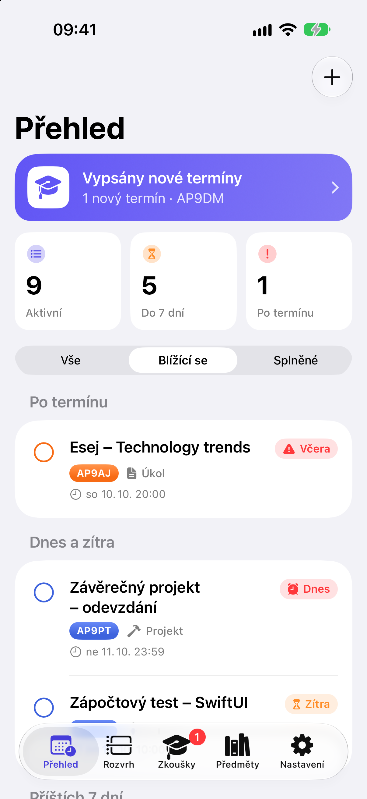
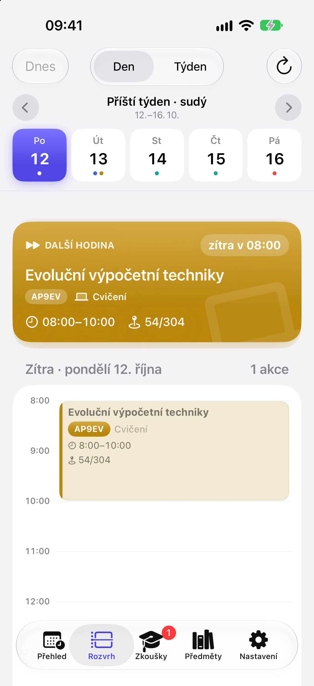
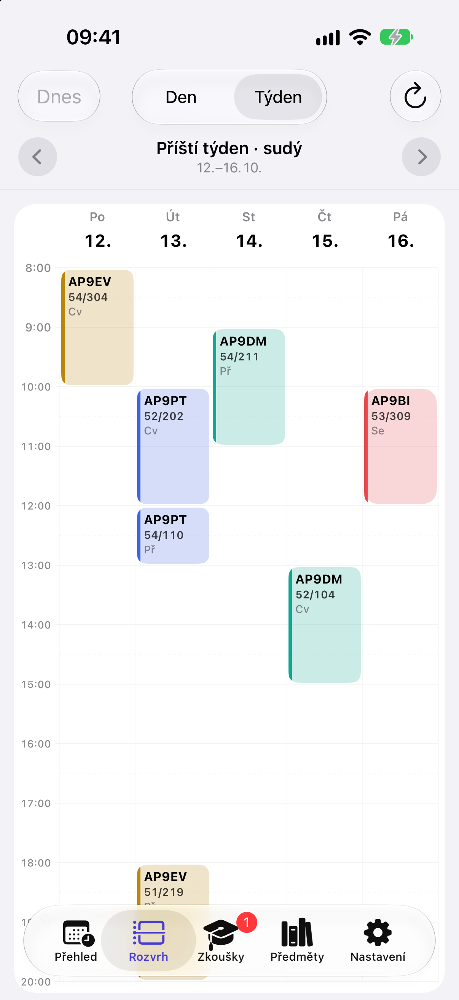
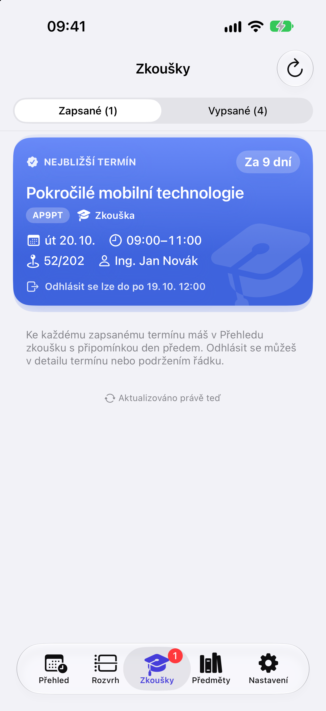
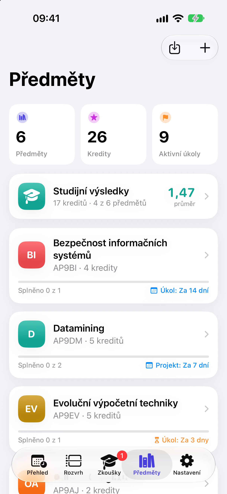
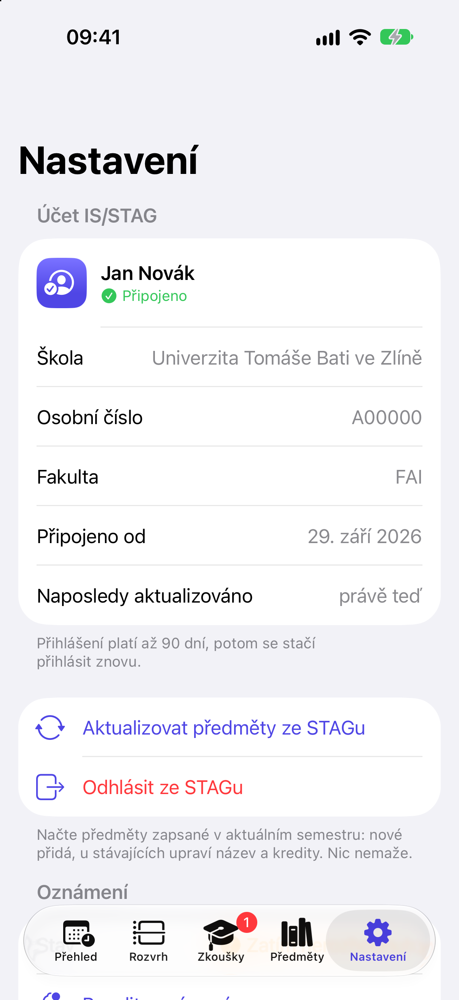
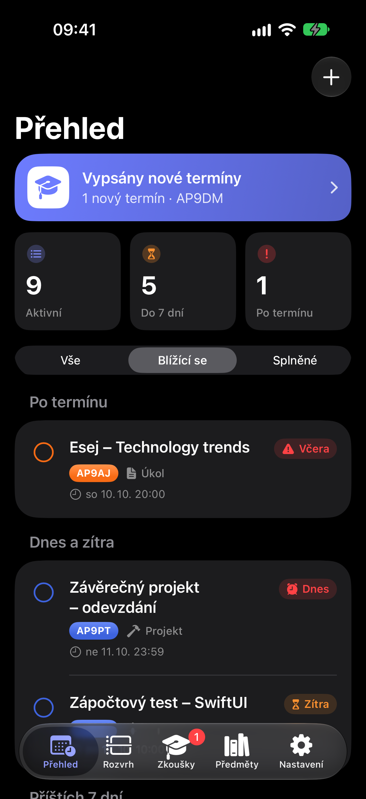

# Termínovník

**Chytrý plánovač zkoušek a deadlinů** pro iOS 17+ ve Swiftu, SwiftUI a SwiftData s architekturou MVVM.
Předměty, rozvrh i termíny zkoušek si načteš přímo z IS/STAG své školy a aplikace ti den před každým termínem pošle připomínku.
Aplikace je v češtině a angličtině.

> **Neoficiální aplikace.** Termínovník není produktem IS/STAG ani žádné univerzity. Názvy škol slouží jen k připojení k jejich veřejnému rozhraní IS/STAG.

<p align="center">
  
  
  
  
</p>
<p align="center">
  
  
  
</p>

*Snímky jsou z demo režimu se smyšlenými daty.* Jak je aplikace postavená (MVVM, SwiftData, STAG API, widgety a hodinky), popisuje **[docs/ARCHITEKTURA.md](docs/ARCHITEKTURA.md)**.

## Funkce

- **Přehled (Dashboard).** Nadcházející nesplněné deadliny seřazené od nejbližšího, rozdělené na *Po termínu*, *Dnes a zítra*, *Příštích 7 dní* a *Později*. Každá položka má barevný odpočet („Dnes“, „Zítra“, „Za 5 dní“), typ úkolu a štítek v barvě předmětu.
- **Odškrtnutí jedním klepnutím** na kolečko, s animací a haptickou odezvou. Swipe doprava splní, swipe doleva upraví nebo smaže.
- **Vyhledávání** (`.searchable`) v názvu, předmětu, kódu, typu i poznámce a segmentový přepínač *Vše / Blížící se / Splněné*.
- **Předměty** v kartách s postupem, kredity a nejbližším deadlinem. Detail předmětu ukazuje kroužek postupu a všechny jeho úkoly.
- **Import ze STAGu.** Po přihlášení školním účtem načte jen předměty, které máš zapsané (název, kód, kredity).
- **Více škol se STAGem:** UTB, ZČU, JČU, TUL, Univerzita Pardubice, UHK a UJEP, případně jiná škola zadáním adresy serveru (ověří se před přihlášením).
- **Čeština a angličtina:** jazyk se přepíná v Nastavení iOS → Termínovník → Jazyk (odkaz je i v Nastavení aplikace).
- **Formulář deadlinu:** předmět, název, typ (zkouška, zápočet, projekt, úkol), datum a čas, poznámka. Při úpravě i stav a body nebo známka.
- **Lokální notifikace 1 den před termínem** s tlačítkem **„Splněno“** přímo v oznámení. Přeplánuje se při každé změně a zruší se po splnění nebo smazání.
- **Rozvrh ze STAGu** v samostatné záložce: denní časová osa a týdenní mřížka, právě probíhající a další hodina, místnost, vyučující. Načítá se přes uložený účet a funguje i offline.
- **Termíny zkoušek ze STAGu** v samostatné záložce: zapsané i vypsané termíny s obsazeností a oknem přihlašování. Zapsané termíny se samy přidají jako zkoušky s připomínkou a na nově vypsané termíny upozorní oznámení.
- **Známky a studijní výsledky ze STAGu:** hodnocení zápočtu a zkoušky u každého předmětu, přehled po semestrech, vážený průměr podle kreditů a získané kredity. Nová známka přijde jako oznámení.
- **Upozornění před hodinou** s nastavitelným předstihem a **Live Activity** s odpočtem probíhající hodiny nebo zkoušky na zamčené obrazovce a v Dynamic Islandu.
- **Siri, Zkratky a Spotlight:** další hodina, rozvrh na den, nejbližší zkouška a přidání deadlinu.
- **Widgety** na plochu a zamčenou obrazovku: *Nejbližší deadliny* s odpočtem a *Další hodina* z rozvrhu.
- **Přidat do Kalendáře** ve formuláři i v nabídce po dlouhém stisku řádku. Systémový editor nepotřebuje přístup ke kalendáři.
- **Nastavení:** připojený účet STAG s aktualizací předmětů jedním klepnutím, stav oznámení, návod k widgetu, smazání dat a informace o aplikaci.
- **Zápis a odhlášení z termínu přímo v aplikaci**, včetně fronty čekatelů u plného termínu. Změna ve STAGu proběhne až po potvrzení v dialogu.
- **Upozornění na změny v rozvrhu:** když STAG zruší nebo přesune hodinu v příštích dvou týdnech, přijde oznámení.
- **Mapa budov:** v detailu hodiny i termínu mapa s budovou a tlačítko *Navigovat* do Apple Map.
- **Interaktivní widget:** deadline se odškrtne kroužkem přímo na ploše.
- **Apple Watch:** další hodina s odpočtem, dnešní rozvrh a nejbližší deadliny.
- **Záloha a obnova do souboru** (třeba na iCloud Drive), slučování podle novější změny. Synchronizace přes iCloud je připravená, viz [docs/ICLOUD_SYNC.md](docs/ICLOUD_SYNC.md).
- **Prázdné stavy**, úvodní obrazovka při prvním spuštění, plná podpora světlého i tmavého režimu a ikona ve třech variantách.

## Struktura projektu

```
ZavernyProjekt/
├── App/TerminovnikApp.swift          vstupní bod aplikace
├── Intents/                          akce pro Siri, Zkratky a Spotlight (App Intents)
├── Models/                           SwiftData modely
│   ├── Subject.swift                 předmět + vazba 1:N na úkoly (cascade)
│   ├── ExamTask.swift                deadline
│   └── TaskType.swift                enum: zkouška, zápočet, projekt, úkol
├── ViewModels/                       logika obrazovek (@Observable)
├── Views/
│   ├── ContentView.swift             záložky + úvodní obrazovka
│   ├── Dashboard/                    přehled, řádek deadlinu, statistiky
│   ├── Subjects/                     seznam, karta, detail, formulář, import ze STAGu
│   ├── Tasks/TaskFormSheet.swift     přidání/úprava deadlinu
│   ├── Onboarding/                   úvodní obrazovka
│   └── Components/                   znovupoužitelné prvky (logo, prázdný stav, štítky…)
├── Services/
│   ├── NotificationManager.swift     lokální notifikace + akce „Splněno“
│   ├── StagService.swift             klient webových služeb IS/STAG
│   ├── StagAccountStore.swift        uložený účet STAG (ticket v Klíčence)
│   ├── StagSubjectSync.swift         aktualizace předmětů ze STAGu
│   ├── TimetableStore.swift          rozvrh studenta ze STAGu (ukládá se do App Group)
│   ├── ExamTermStore.swift           termíny zkoušek ze STAGu, převod zapsaných na zkoušky, nové termíny
│   ├── GradeStore.swift              známky a studijní výsledky ze STAGu, upozornění na nové známky
│   ├── BackgroundRefresh.swift       kontrola termínů na pozadí (Background App Refresh)
│   ├── PersistenceController.swift   sdílený ModelContainer (aplikace i App Intents)
│   ├── ClassReminderScheduler.swift  upozornění před hodinou
│   ├── LiveActivityManager.swift     Live Activity hodiny / zkoušky
│   ├── WidgetSync.swift              zápis dat pro widget do App Group
│   ├── TaskService.swift             sdílené operace (splnění, mazání)
│   └── SampleData.swift              ukázková data a data pro #Preview
└── Helpers/                          pomocné rozšíření pro modely
Shared/                               kód sdílený aplikací a widgetem (barvy, odpočet, data pro widget)
ZkouskovnikWidget/                    rozšíření s widgety (WidgetKit)
TerminovnikWatch/                     aplikace pro Apple Watch (watchOS 10+)
ZavernyProjektTests/                  unit testy (Swift Testing)
docs/                                 architektura, bezpečnostní audit, zásady ochrany údajů, iCloud, screenshoty
Tools/RenderAppIcon.swift             generátor ikony z AppLogoView
```

### Jak je řešené MVVM se SwiftData

`@Query` funguje jen uvnitř View, protože jen tam se automaticky překresluje při změně dat. View proto data načte a předá je ViewModelu. ViewModel (`@Observable`) řeší filtrování, vyhledávání, seskupení, validaci formulářů a akce. Formuláře drží rozpracované hodnoty ve ViewModelu, takže „Zrušit“ nic nezmění a data se zapíšou až po „Uložit“.

## Nastavení v Xcode

1. Otevři `ZavernyProjekt.xcodeproj` v Xcode 26 nebo novějším.
2. V **Signing & Capabilities** vyber svůj tým, pokud chceš aplikaci spustit na fyzickém iPhonu. Bundle ID si případně změň.
3. Vyber simulátor nebo zařízení s iOS 17+ a spusť aplikaci pomocí ⌘R.

Projekt používá složku synchronizovanou se souborovým systémem. Nové soubory ve složce `ZavernyProjekt/` se do targetu přidají automaticky. Žádné balíčky ani klíče v Info.plist nejsou potřeba.

### Konfigurace ModelContaineru

Kontejner se vytváří jednou ve `Services/PersistenceController.swift`. Sdílí ho aplikace i akce pro Siri a Zkratky, které běží bez otevřeného UI:

```swift
enum PersistenceController {
    static let shared: ModelContainer = {
        let schema = Schema([Subject.self, ExamTask.self])
        let configuration = ModelConfiguration(schema: schema, isStoredInMemoryOnly: false)
        do {
            return try ModelContainer(for: schema, configurations: [configuration])
        } catch {
            fatalError("Nepodařilo se vytvořit ModelContainer: \(error)")
        }
    }()
}

@main
struct TerminovnikApp: App {
    let modelContainer: ModelContainer = PersistenceController.shared

    var body: some Scene {
        WindowGroup { ContentView() }
            .modelContainer(modelContainer)   // všechna View pak mají @Query a modelContext
    }
}
```

- `Schema` vyjmenuje modely. Vazbu `Subject.tasks` ↔ `ExamTask.subject` SwiftData odvodí z `@Relationship(deleteRule: .cascade, inverse:)`.
- `isStoredInMemoryOnly: false` ukládá data trvale do SQLite. Protože má aplikace App Group, SwiftData databázi automaticky ukládá do sdíleného kontejneru App Group (`Library/Application Support/default.store`), ne do kontejneru aplikace.
- Previews používají vlastní kontejner v paměti s ukázkovými daty (`SampleData.previewContainer`) nebo prázdný `.modelContainer(for: [...], inMemory: true)`.
- Ve View se k datům přistupuje přes `@Query(sort: \ExamTask.dueDate)` a `@Environment(\.modelContext)`.

## Import předmětů ze STAGu

Aplikace používá REST rozhraní IS/STAG zvolené školy (seznam škol je v `Models/StagSchool.swift`, např. UTB `https://stag-ws.utb.cz/ws`).

1. Na úvodní obrazovce nebo v záložce **Předměty** (ikona stažení) zvol **Přihlásit se do IS/STAG**.
2. Systém otevře zabezpečený prohlížeč (`ASWebAuthenticationSession`) s přihlášením UTB.
3. STAG po přihlášení přesměruje na `zkousky://stag-login?stagUserTicket=…&stagUserInfo=…`. Aplikace z toho získá dočasný ticket a osobní číslo studenta.
4. Služba `predmety/getPredmetyByStudent` vrátí předměty zapsané ve zvoleném semestru. Rozvrh načítá služba `rozvrhy/getRozvrhByStudent`. Ty, které už v aplikaci máš, jsou označené a nevybírají se.
5. Chybějící kredity se doplní z veřejné služby `predmety/getPredmetInfo`.

**Soukromí:** aplikace heslo nikdy nevidí. Dlouhodobý ticket (`longTicket=1`, platí až 90 dní) se ukládá do Klíčenky, takže import i aktualizace v Nastavení fungují bez nového přihlášení. Odhlášením se ticket smaže. Další školu přidáš do `StagSchool.all`; uživatel může zadat i vlastní adresu serveru (jen HTTPS).

## Termíny zkoušek

Termíny se načítají službou `terminy/getTerminyProStudenta` přes uložený účet. Kontrolují se při každém otevření aplikace a průběžně na pozadí (Background App Refresh). Kontrolu na pozadí spouští iOS podle svého uvážení, takže upozornění na nový termín může přijít se zpožděním. Okamžitá upozornění při zavřené aplikaci by vyžadovala vlastní server s push notifikacemi.

Zapsané termíny se převádí na zkoušky (`ExamTask.stagTermID`) s připomínkou den předem. Po odhlášení z termínu ve STAGu se taková zkouška z aplikace odstraní.

## Známky

Známky se načítají dvěma službami: `znamky/getZnamkyByStudent` (zápočet a zkouška s datem, pokusem a zkoušejícím) a `student/getStudentPredmetyAbsolvoval` (názvy, kredity, výsledná známka a absolvování za celé studium). Výsledky se spojí podle katedry, kódu, roku a semestru. Vážený průměr počítá jen klasifikované předměty (A = 1 … F = 4) vážené kredity a je orientační.

## Widget a App Group

Widget nemá přístup k databázi aplikace. Aplikace proto po každé změně zapíše přehled nejbližších deadlinů do sdíleného úložiště App Group `group.cz.liborvyleta.terminovnik` a widget ho jen čte. Na simulátoru funguje bez dalšího nastavení. Pro fyzický iPhone musí tvůj vývojářský tým povolit schopnost App Groups. Když změníš bundle ID aplikace, uprav i bundle ID widgetu tak, aby jím začínalo.

## Notifikace

- O povolení se aplikace zeptá v kontextu, při prvním uložení deadlinu, jak doporučují Apple Human Interface Guidelines.
- Připomínka přijde přesně 1 den před termínem ve stejný čas. U termínu za méně než 24 hodin se už nenaplánuje a formulář na to upozorní.
- **Rychlý test:** vytvoř deadline na zítřek o 2 minuty později, než je teď. Připomínka přijde za 2 minuty. Banner se ukáže i při otevřené aplikaci.

## První spuštění a ukázková data

- Aplikace startuje s **prázdnou databází**. Úvodní obrazovka nabídne přihlášení do STAGu a import tvých zapsaných předmětů. Jde ji přeskočit a předměty přidat ručně.
- Ukázková data (`SampleData`) slouží jen pro SwiftUI Previews. Pro ruční testování je lze vložit argumentem `-seedSampleData` v **Product → Scheme → Edit Scheme → Run → Arguments**. Ve schématu není nastavený, funguje jen v Debug buildu a jen nad prázdnou databází.
- **Ukázkový režim** (i v Release, pro vyzkoušení bez školního účtu a pro App Review): tlačítko **„Vyzkoušet s ukázkovými daty“** na úvodní obrazovce nebo v Nastavení (když není přihlášený účet STAG). Aplikace se přepne za běhu bez restartu (`Services/DemoMode.swift` – `DemoController` vymění `ModelContainer` a znovu sestaví strom pohledů) na smyšlený účet, předměty, deadliny, rozvrh, termíny, známky a budovy (`Models/DemoData.swift`). Vše je jen v paměti: do skutečné databáze, App Group (widget, cache), Klíčenky ani do plánovaných připomínek se nic nezapisuje, síť se nevolá, zápis na termín je vypnutý a záloha také. Nahoře je pruh „Ukázkový režim – smyšlená data“ s tlačítkem **Ukončit** (také v Nastavení). Po ukončení se vrátí skutečná data, účet a připomínky. Příznak `demoModeActive` v UserDefaults přetrvá i po restartu aplikace.
- Pro screenshoty lze ukázkový režim v Debug buildu zapnout i argumentem `-demo`, volitelně s `-tab dashboard|timetable|terms|subjects|settings` a `-timetableMode day|week`, např. `xcrun simctl launch booted cz.liborvyleta.terminovnik -demo -tab timetable`.
- Pro opakování „prvního spuštění“ aplikaci ze simulátoru smaž. Tím se smaže i databáze a stav úvodní obrazovky.

## Siri a Zkratky

Akce se po instalaci samy objeví v aplikaci Zkratky a ve Spotlightu. Siri česky neumí, proto mají zkratky i anglické fráze pro hlasové ovládání, například „Next class in Termínovník“.

## Lokalizace

Zdrojový jazyk je čeština, překlady jsou v `Shared/Localizable.xcstrings` (sdílí ho aplikace i widget). Tvary podle počtu (1 kredit / 2 kredity / 5 kreditů) řeší plural variations v katalogu. Nové texty se do katalogu přidají při buildu v Xcode.

## Testy

Unit testy jsou ve složce `ZavernyProjektTests` (Swift Testing) a pracují jen s databází v paměti. Spuštění: ⌘U v Xcode, nebo

```bash
xcodebuild test -project ZavernyProjekt.xcodeproj -scheme ZavernyProjekt \
  -destination 'platform=iOS Simulator,name=iPhone 18 Pro' -testLanguage cs -testRegion CZ
```

## Soukromí a App Store

- Bezpečnostní a compliance audit podle App Store Review Guidelines: `docs/BEZPECNOSTNI_AUDIT.md`.
- Zásady ochrany osobních údajů: v aplikaci (Nastavení → Zásady ochrany osobních údajů) a ke zveřejnění na webu v `docs/ZASADY_OCHRANY_UDAJU.md`. Před odesláním do App Store je zveřejni a doplň adresy v `Models/AppInfo.swift`.
- Privacy Manifest (`PrivacyInfo.xcprivacy`) má aplikace i widget. Aplikace nesbírá žádná data (App Privacy: „Data Not Collected“).

## Ikona

Logo je nakreslené ve SwiftUI (`Views/Components/AppLogoView.swift`) a stejný kód je použitý na úvodní obrazovce. Ikona se z něj vygeneruje takto:

```bash
swiftc -parse-as-library ZavernyProjekt/Views/Components/AppLogoView.swift \
  Shared/Color+Hex.swift Tools/RenderAppIcon.swift -o /tmp/render-icon
/tmp/render-icon ZavernyProjekt/Assets.xcassets/AppIcon.appiconset
```
