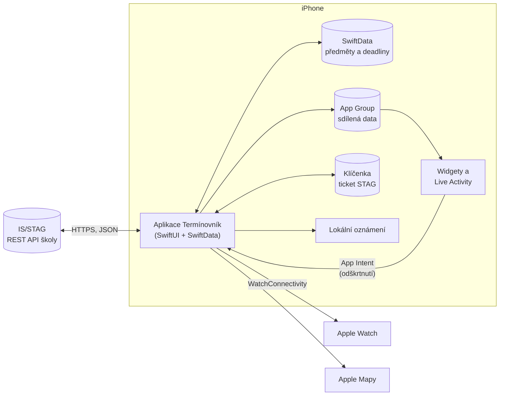
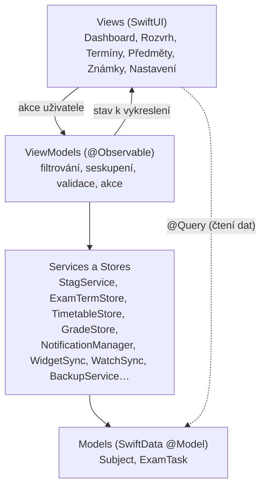
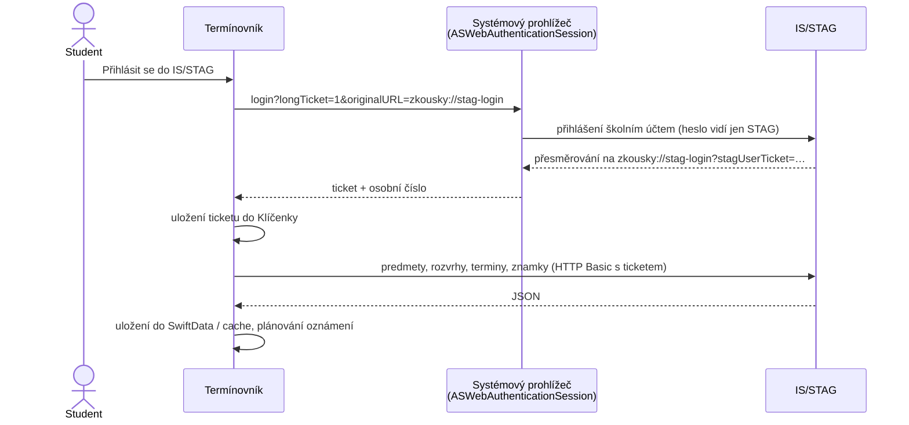
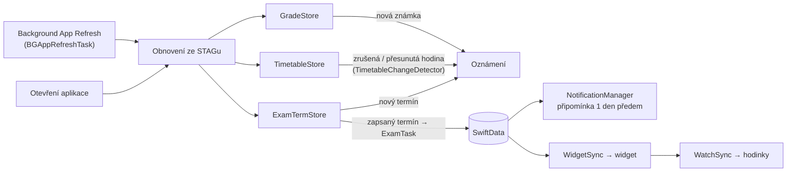

# Architektura Termínovníku

Tento dokument popisuje, jak je aplikace postavená: z jakých částí se skládá, jak mezi nimi tečou data a proč jsou zvolená daná řešení.

## Přehled

Termínovník se skládá ze čtyř targetů v jednom Xcode projektu:

| Target | Platforma | Úloha |
|---|---|---|
| **ZavernyProjekt** (aplikace Termínovník) | iOS 17+ | hlavní aplikace: UI, databáze, komunikace se STAGem |
| **ZkouskovnikWidget** | iOS 17+ | widgety na plochu a zamčenou obrazovku, Live Activity |
| **TerminovnikWatch** | watchOS 10+ | aplikace pro Apple Watch |
| **ZavernyProjektTests** | iOS | unit testy (Swift Testing) |

Kód, který potřebuje víc targetů (formát dat pro widget a hodinky, odpočty, barvy, katalog překladů), je ve složce `Shared/`.

## Vrstvy aplikace (MVVM)

- **Views** jen vykreslují stav a předávají akce. Data z databáze čtou přes `@Query`, protože jen uvnitř View se SwiftUI automaticky překreslí při změně dat. Načtená data předají ViewModelu.
- **ViewModels** (`@Observable`) obsahují logiku obrazovky: vyhledávání, filtry, seskupení podle termínu, validaci formulářů. Formulář drží rozpracované hodnoty ve ViewModelu, takže „Zrušit“ nic nezmění a do databáze se zapíše až „Uložit“.
- **Services a Stores** jsou sdílené singletony (`.shared`) pro práci se sítí, oznámeními, widgety a hodinkami. Stores (`TimetableStore`, `ExamTermStore`, `GradeStore`, `BuildingStore`) jsou `@Observable`, takže na ně View může přímo navázat.
- **Models** jsou dvě SwiftData entity: `Subject` (předmět) a `ExamTask` (deadline), vazba 1:N s kaskádovým mazáním.

Aplikace používá výchozí izolaci `MainActor` (Swift 6.2 „approachable concurrency“). UI a databáze tak běží na hlavním vlákně bez ručního přepínání a síťová volání jsou `async`.

## Data a jejich uložení

| Data | Kde | Proč |
|---|---|---|
| Předměty a deadliny | SwiftData (SQLite) v kontejneru App Group | vlastní data uživatele, App Intents k nim mají přístup i bez otevřeného UI |
| Rozvrh, termíny, známky, budovy | JSON v `UserDefaults` App Group | cache ze STAGu: funguje offline a widget i hodinky ji mohou číst |
| Ticket STAG a účet | Klíčenka (`kSecAttrAccessibleAfterFirstUnlockThisDeviceOnly`) | citlivý údaj, nesmí do zálohy ani do jiného zařízení |
| Přehled pro widget | `WidgetSnapshot` v App Group | widget nemá přístup k databázi aplikace |
| Záloha | soubor `.terminovnik` (JSON) | uživatel ji uloží třeba na iCloud Drive |

Synchronizace přes iCloud (CloudKit) je připravená, ale vypnutá, protože vyžaduje placený Apple Developer účet. Modely jsou s CloudKitem kompatibilní a zapíná se build flagem `ICLOUD_SYNC`, viz [ICLOUD_SYNC.md](ICLOUD_SYNC.md).

## Komunikace s IS/STAG

`StagService` je klient REST webových služeb IS/STAG. Adresa serveru se bere z vybrané školy (`StagSchool`, např. UTB `https://stag-ws.utb.cz/ws`).

- Aplikace heslo nikdy nevidí. Dlouhodobý ticket platí až 90 dní. Když vyprší (HTTP 401), aplikace uživatele odhlásí a požádá o nové přihlášení.
- Dekódování je tolerantní (`StagFlexible`): STAG posílá čísla jako text, příznaky jako `A`/`N` a hodnoty občas obalené v `{"value": …}`. Jedna chybná položka nezpůsobí pád celého seznamu.

Použité služby:

| Služba | Přihlášení | Účel |
|---|---|---|
| `kalendar/getAktualniObdobiInfo` | ne | aktuální semestr |
| `predmety/getPredmetyByStudent`, `getPredmetInfo` | ano / ne | zapsané předměty, kredity |
| `rozvrhy/getRozvrhByStudent` | ano | rozvrh |
| `terminy/getTerminyProStudenta` | ano | zapsané a vypsané termíny zkoušek |
| `terminy/zapisStudentaNaTermin`, `odhlasStudentaZTerminu`, `zapisStudentaDoFronty`, `odhlasStudentaZFronty` | ano | zápis a odhlášení (vždy až po potvrzení uživatelem) |
| `znamky/getZnamkyByStudent`, `student/getStudentPredmetyAbsolvoval` | ano | známky a studijní výsledky |
| `mistnost/getBudovy` | ne | adresy a GPS budov pro mapu |

## Obnova dat a upozornění

- Při každém otevření aplikace a průběžně na pozadí se obnoví termíny, rozvrh a známky. Kdy úlohu na pozadí spustí, rozhoduje iOS, takže upozornění může přijít se zpožděním. Okamžitá upozornění by potřebovala vlastní server s push notifikacemi.
- **Změny v rozvrhu** porovnává čistá funkce `TimetableChangeDetector.diff(old:new:)`: hodiny páruje podle ID akce a hlásí zrušené, přesunuté a nové hodiny v příštích 14 dnech. Neporovnává rozvrh jiného účtu nebo semestru a stejnou změnu neoznámí dvakrát.
- Zapsané termíny se převádí na `ExamTask` se `stagTermID`, takže dostanou připomínku stejně jako ručně přidané deadliny.

## Widgety, Live Activity a hodinky

- **Widgety** čtou `WidgetSnapshot` a `TimetableSnapshot` z App Group. Aplikace je po každé změně přepíše (`WidgetSync`) a zavolá `WidgetCenter.reloadAllTimelines()`.
- **Interaktivní widget:** kroužek u deadlinu je `Button(intent:)` s `CompleteDeadlineIntent`. Intent je zároveň `LiveActivityIntent`, takže ho systém spustí v procesu aplikace, která smí zapisovat do databáze. Pro jistotu existuje i záložní fronta v App Group, kterou aplikace zpracuje při dalším spuštění.
- **Live Activity** (ActivityKit) ukazuje odpočet probíhající hodiny nebo zkoušky na zamčené obrazovce a v Dynamic Islandu.
- **Apple Watch:** `WatchSync` posílá přes `WCSession.updateApplicationContext` nejbližší deadliny a rozvrh. Hodinky si poslední data uloží, takže fungují i bez spojení s telefonem.

## Testy

Testy používají Swift Testing a databázi jen v paměti. Pokrývají hlavně čistou logiku, kterou jde ověřit bez sítě:

- dekódování odpovědí STAGu (předměty, rozvrh, termíny, známky, zápis na termín),
- převod známek a vážený průměr,
- výskyty hodin v rozvrhu (včetně přechodu na letní čas),
- detekci změn v rozvrhu,
- zálohu a obnovu (sloučení, nahrazení, poškozený soubor),
- ViewModely (filtry, seskupení, validace formulářů).

## Bezpečnost a soukromí

- Žádná data neodchází jinam než na server STAG vybrané školy (jen HTTPS). Aplikace nemá analytiku ani reklamy.
- Ticket je v Klíčence, odhlášení smaže ticket, cache i cookies.
- Zápis na termín (ostrá změna ve STAGu) se provede jen po potvrzení v dialogu.
- Podrobnosti jsou v [BEZPECNOSTNI_AUDIT.md](BEZPECNOSTNI_AUDIT.md).
